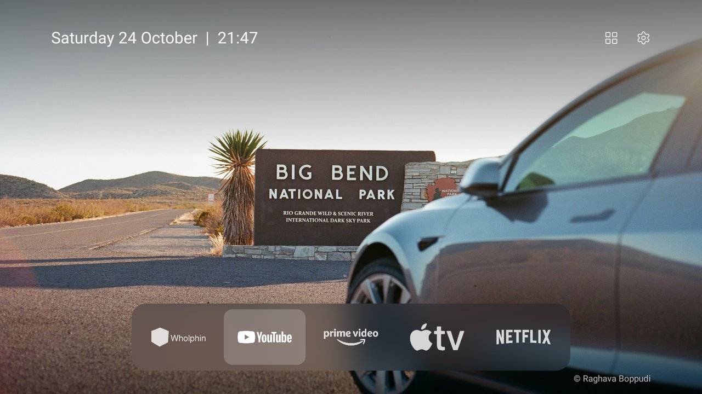
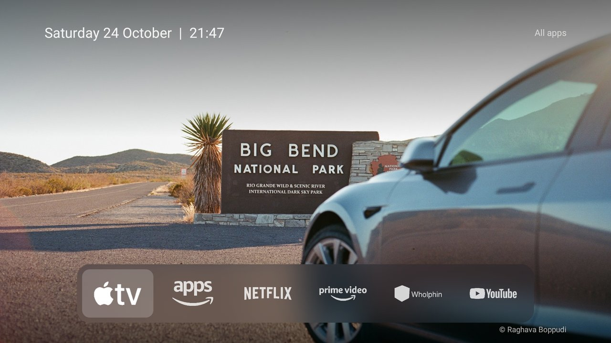
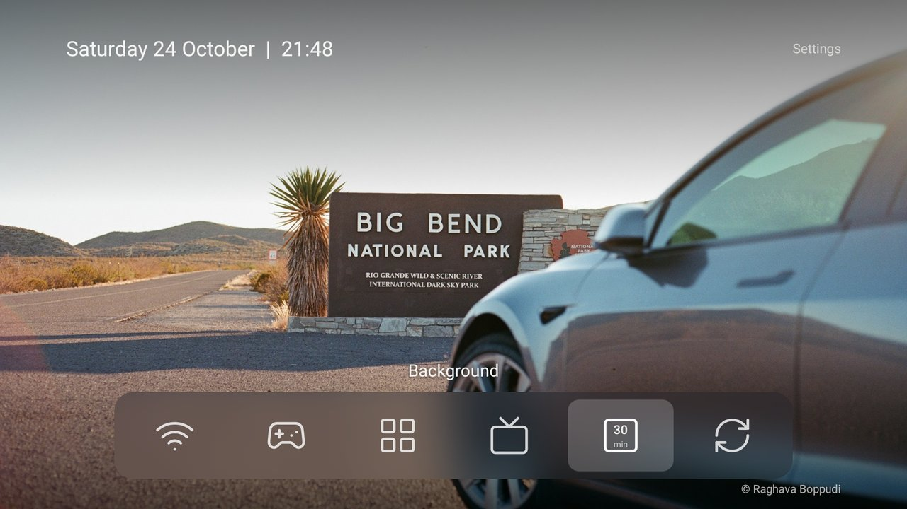

# FireOS-clean

**A minimal home screen for Fire TV Stick, with your own wallpapers.**

Amazon's home is full of banners, sponsored rows and autoplay. This replaces it with a wallpaper, one line of date and
time, and a small frosted dock of your apps, last used first. Your own photos rotate behind it, pulled from a GitHub
repository you control (public or private), with a credit line for the photographer.



| All apps | Settings |
|---|---|
|  |  |

(Shown with wallpapers pulled from a GitHub repository.)

## What you get

- **Wallpaper first.** The dock is small and sits low, so the picture has the screen. White marks only; the wallpaper is the only colour.
- **Apps, last used first.** Marks are cut from each app's own artwork, so apps you install later fit in automatically. Appstore and every other app are under **All apps**.
- **Your own wallpapers from GitHub.** Add images to a repository, name them `1-First-Last.jpg`, and the TV shows them in order with `© First Last`. Any image size works: 100-megapixel photos are cut to 16:9 on the stick, a piece at a time. Public or private repository. With none, 12 built-in gradients are used.
- **Settings in the same style.** Network, Controllers & Bluetooth, Applications, My Fire TV, how often the wallpaper changes (30 seconds to daily) and a Refresh button.
- **Covers Amazon's home completely.** A "Launching Home" screen is held until the new home is really on screen, so Amazon's home is never seen. It also starts early at boot and survives restarts.
- **No account, no cloud, no tracking.** The only network use is reading your wallpaper repository, and only if you set one.
- **Reversible.** One command puts Amazon's home back.

## How it works

Fire OS won't let another app be the default home. So the app watches the system log for Amazon's home starting (a permission
you grant once over ADB), covers it, and brings its own home up. Because it relies on ADB, it works on Fire TV devices that
let you switch on **ADB debugging** (Settings > My Fire TV > Developer options). Tested on a Fire TV Stick Lite (Fire OS 7,
Android 9); other Fire OS 7 devices should work, and Fire OS 5 is untested for the home screen. It is not affiliated with Amazon.

## Requirements

- A Fire TV with ADB debugging on, and a computer on the same network (macOS or Linux; a JDK 17 and the Android SDK to build).
- Optional: a GitHub account for your own wallpapers.

## Build and install

1. **On the Fire TV:** Settings > My Fire TV > Developer options > **ADB debugging** on. No Developer options? Go to My Fire TV >
   About, press OK seven times on the device name, then go back. Note the IP address under About > Network.
2. **On your computer:** clone this repository and set up the Python tools:
   ```bash
   git clone https://github.com/RaghavaBoppudi/FireOS-clean.git && cd FireOS-clean
   python3 -m venv tools/venv && tools/venv/bin/pip install -r tools/requirements.txt
   ```
3. **Install a JDK 17 and the Android SDK** (build-tools and a platform). On macOS:

```bash
brew install openjdk@17 && brew install --cask android-commandlinetools
export JAVA_HOME="$(brew --prefix openjdk@17)" PATH="$(brew --prefix openjdk@17)/bin:$PATH"
yes | sdkmanager --sdk_root="$HOME/Library/Android/sdk" --licenses
sdkmanager --sdk_root="$HOME/Library/Android/sdk" "build-tools;34.0.0" "platforms;android-28"
```

On Linux install a JDK 17 and the [command-line tools](https://developer.android.com/studio#command-line-tools-only),
then run the same `sdkmanager` line with `--sdk_root="$HOME/Android/Sdk"`. `firehome/build.sh` finds the SDK in
`$ANDROID_HOME`, `~/Library/Android/sdk` or `~/Android/Sdk`.

4. **Build and install.** The first time, accept "Allow USB debugging?" on the TV.

```bash
export TV_HOST=192.168.1.50                  # your stick's IP address
firehome/install.sh                          # build, install, grant permissions, open it
firehome/install.sh --remove                 # undo: Amazon's home is back on the next Home press
```

`install.sh` grants `READ_LOGS`, draw-over-apps and usage-access over ADB and allows the boot listener. Tested on
Fire OS 7 (Android 9); Fire OS 5 needs its own check.

## Your own wallpapers

Out of the box the home uses 12 gradients built into the app. To show your own images, the app downloads them from
a GitHub repository of yours, public or private. Set it up once:

1. **Create the repository.** On GitHub choose **New repository**, give it a name such as `tv-wallpapers`, set it
   to **Public** (or Private, see below) and create it. (It can be empty. Public is simplest; for a private one see below.)
2. **Add images.** Open the repository, choose **Add file > Upload files**, drag your images in and **Commit changes**.
   Use JPG, PNG or WebP at the **top level** (not in a folder). **16:9** images are ideal (1920 × 1080 is enough, 3840 × 2160
   is plenty). Any other shape or size is fine too: the TV cuts the middle 16:9 out of it and scales it to 1920 × 1080
   itself, one image at a time, in the background, so even a 100-megapixel photo is safe. GitHub's own limit of 100 MB
   per file applies, and smaller files simply download faster.
   From a terminal: `git add . && git commit -m "Add wallpapers" && git push`.
   The folder [`wallpaper-repo-template/`](wallpaper-repo-template/) has a ready-made README you can copy into the repository.
3. **Name the files to order and credit them.** Name each image `NUMBER-First-Last.jpg`, for example
   `1-Raghava-Boppudi.jpg`, `2-Allen-Daniel.jpg`. The number is the order the wallpapers rotate in (1, 2, 3 ... 10, 11
   are in numeric order). The words after it are the photographer: the screen shows `© Raghava Boppudi` bottom right.
   A file with no number in front is shown after the numbered ones, and with no credit. Rename a file on GitHub with
   the pencil icon on its page, or with `git mv`.
4. **Point the app at it.** Edit [`firehome/res/values/config.xml`](firehome/res/values/config.xml) and set
   `wallpaper_repo` to `YOUR-GITHUB-USERNAME/YOUR-REPO-NAME`. If the images are in a folder, put its name in
   `wallpaper_path`. Then run `firehome/install.sh` again.
5. **Check it.** On the TV open **Settings > Refresh wallpapers**. It says "N wallpapers from GitHub" when it found
   your images. After that new images are picked up automatically, every 30 minutes, whenever Home opens.

### Keeping the repository private

Your images can stay private, so only you can see them and the TV still gets them. The TV then needs a read-only
**access token**:

1. On GitHub open **Settings > Developer settings > Personal access tokens > Fine-grained tokens > Generate new token**.
2. Set **Repository access** to **Only select repositories** and choose your wallpaper repository. Under **Permissions >
   Repository permissions** set **Contents** to **Read-only**. Nothing else. Pick an expiry (a year is reasonable).
3. Copy the token (it starts with `github_pat_`). Save it in the git-ignored file `firehome/wallpaper-token`, or pass it for one run:
   `WALLPAPER_TOKEN=github_pat_... firehome/install.sh`. The installer sends it to the TV over ADB; it is kept in the app's
   private storage, **not** in the APK and not in git, and is only ever sent to GitHub.
4. Open **Settings > Refresh wallpapers** on the TV. "GitHub won't show this TV the repository" means the name or the token is wrong.
   Remove the token any time with `firehome/install.sh --clear-token`. When it expires, make a new one and run `install.sh` again.

Anyone with ADB access to your TV could read the token, which is why it should be read-only and for this one repository.
Before switching a repository to private, install with the token first: until then the TV can't see it.

How it behaves:

| Situation | What the TV shows |
|---|---|
| The repository has at least one valid image | Only your images, in number order |
| The repository is empty or has no valid images | The built-in gradients |
| No repository is set in `config.xml` | The built-in gradients, and no network use |
| GitHub is unreachable | The last images it downloaded; the gradients if there are none |

If Refresh says "no images yet": check the repository is **public**, the images are on the default branch at the top
level, and that opening `https://api.github.com/repos/YOUR-GITHUB-USERNAME/YOUR-REPO-NAME/contents/` in a browser lists them.
Anyone who can push to the repository controls your wallpapers, so keep its write access to yourself, and only
add images you have the right to publish. The built-in gradients are generated by
[`firehome/wallpapers/generate.py`](firehome/wallpapers/generate.py) (needs Pillow) and are CC0. Icons are
[Lucide](https://lucide.dev) (ISC); see [`firehome/NOTICE.md`](firehome/NOTICE.md).

---

# Also in this repo: debloat tools for Fire TV

The repository began as tooling to clean up an Amazon Fire TV Stick over Wi-Fi even with **no remote**: a remote in your
browser, backup-first debloat scripts with a one-line undo, and debloat lists for five devices. These are optional and
independent of the home screen.

## What's in the toolbox

| Path | What it does |
|---|---|
| [`tools/remote.py`](tools/remote.py) | **A usable remote in your browser**: D-pad, OK, Back, Home, Menu, media and volume keys, arrow-key shortcuts, typing into the TV and a live screen preview. Works over ADB, or with `--no-adb` through the Fire TV app's API. |
| [`tools/firetv.py`](tools/firetv.py) | Pairs with the stick through the same local API Amazon's Fire TV phone app uses (a PIN shows on the TV) and presses keys, with no ADB and no remote. This is how you reach Developer options on a stick without a remote. |
| [`tools/tv.py`](tools/tv.py) | Pure-Python ADB client (shell, batch, push, pull); works where macOS blocks the `adb` binary. |
| [`tools/disable.sh`](tools/disable.sh), [`restore.sh`](tools/restore.sh) | Record each package's state, then switch the list off; restore replays the record. `HIDE=1` for Fire OS 5. |
| [`examples/`](examples/) | Debloat lists for five Fire TV devices. |

## Quick start (debloat tools)

```bash
git clone https://github.com/RaghavaBoppudi/FireOS-clean.git && cd FireOS-clean
python3 -m venv tools/venv && tools/venv/bin/pip install -r tools/requirements.txt
export TV_HOST=192.168.1.50                      # the stick: Settings > My Fire TV > About > Network
```

**No remote? Pair the browser remote first.** A 4-digit PIN appears on the TV:

```bash
python3 tools/firetv.py pair
python3 tools/firetv.py verify 1234                 # the PIN on screen
tools/venv/bin/python -I tools/remote.py --no-adb   # opens http://127.0.0.1:8765
```

Use it to turn on **Settings > My Fire TV > Developer options > ADB debugging**. No Developer options? Go to My
Fire TV > About, press OK seven times on the device name, then go back. Accept "Allow USB debugging?" on the TV.

```bash
tools/venv/bin/python -I tools/tv.py --probe                                    # model, Fire OS, Android
HIDE=1 tools/disable.sh examples/amazon-fire-tv-stick-2nd-gen-aftt/debloat.txt   # back up, then switch off
firehome/install.sh                                                             # the new home screen
```

Fire OS 5 allows one ADB connection at a time, so keep the remote on `--no-adb` while the scripts run. Fire OS
6 and 7 don't need `HIDE=1`.

## Or let Claude Code do it

Open Claude Code in this folder and tell it something like:

> Debloat my Fire TV Stick at 192.168.1.50 with this repo's tools. Back up first, ask me which apps I use,
> keep Wi-Fi, remote, Bluetooth and Appstore services, switch things off in small batches and check each one
> with a screenshot, and give me the undo command.

## What Fire OS 5.2.9.5 allows, and what it blocks

| Tried | Result on the 2nd-gen stick |
|---|---|
| `pm disable-user` | Refused for every package: `SecurityException: Permission Denial` |
| `pm hide` | Works for apps you installed; refused for Amazon's system apps |
| `pm uninstall -k --user 0` | Refused (`DELETE_FAILED_INTERNAL_ERROR`), and Android 5.1 couldn't undo it anyway |
| Accessibility service over ADB | Silently dropped, so `firehome` watches the system log (`READ_LOGS`) instead |
| Animation scales, `pm grant READ_LOGS` | Allowed |

So on this firmware the debloat hid seven unused apps and sped up animations, while Prime Video, Alexa,
Amazon's ads and telemetry stay installed. The home-screen swap is what makes the stick feel lighter: Amazon's
home, its full-screen ads and sponsored tiles stop coming up. Newer Fire OS lets ADB disable much more.

## Fire TV lists

| TV | OS |
|---|---|
| Amazon Fire TV Stick 2nd gen (AFTT, tank), India | Fire OS 5.2.9.5 / Android 5.1 |
| Amazon Fire TV Stick Lite (AFTSS, sheldon) | Fire OS 7 / Android 9 |
| Amazon Fire TV Stick 4K, 1st gen 2018 (AFTMM, mantis) | Fire OS 6.7.1.1 / Android 7.1 |
| Insignia 55" F30 4K Fire TV (NS-55F301NA25, AFTDCT31, duckie) | Fire OS 7 / Android 9 |
| Toshiba Fire TV (AFTHA004, hazel) | Fire OS 7 / Android 9 |

## Safety and undo

- Nothing is uninstalled. `disable.sh` writes each package's state to `~/.cleanyourtv/` before changing
  anything; `HIDE=1 tools/restore.sh <list> com.amazon.tv.launcher` puts it back. `firehome/install.sh --remove`
  brings Amazon's home back.
- **With no remote, Wi-Fi is the only way in.** The lists keep every Wi-Fi provisioning, remote-API, Bluetooth
  and pairing service. A factory reset is no fallback either: setup after a reset needs a physical remote.
- After every restart Fire OS shows "We cannot detect your remote"; press OK in the browser remote.
- Network ADB is full control of the stick. Switch ADB debugging off when you're done, once you have another way
  to control it (a replacement remote, or the Fire TV phone app).

## Credits

Built on [CleanYourTV](https://github.com/Gathin23/cleanyourtv) by Gathin23 (MIT): the ADB client, the
backup/restore scripts and the Fire OS 6 and 7 lists come from there. The browser remote (`tools/remote.py`), the PIN
pairing tool (`tools/firetv.py`) and the Fire TV Stick 2nd gen list were added by [whyashthakker](https://github.com/whyashthakker),
who adapted CleanYourTV for sticks without a remote. The home screen in `firehome/` is by Raghava Boppudi. MIT licence, see [`LICENSE`](LICENSE).
