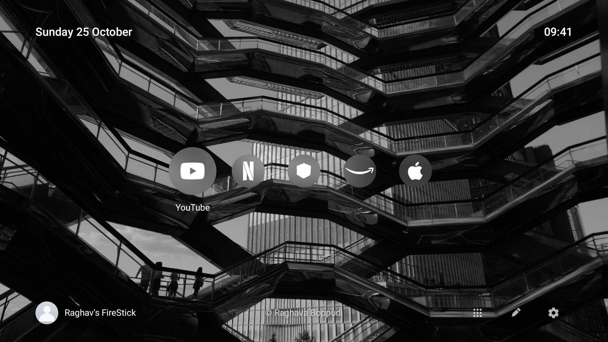
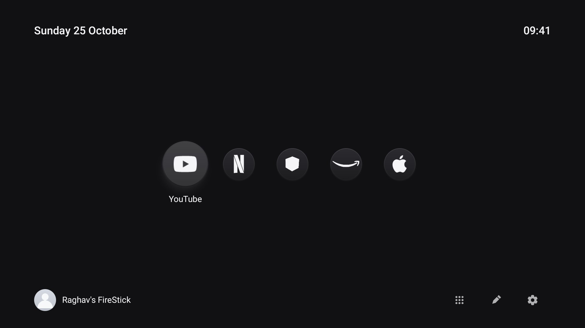
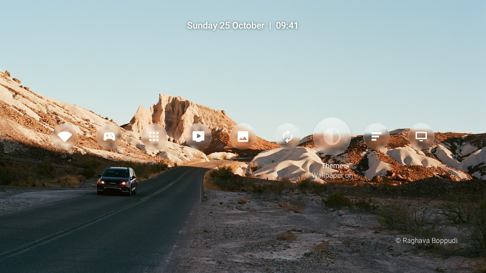
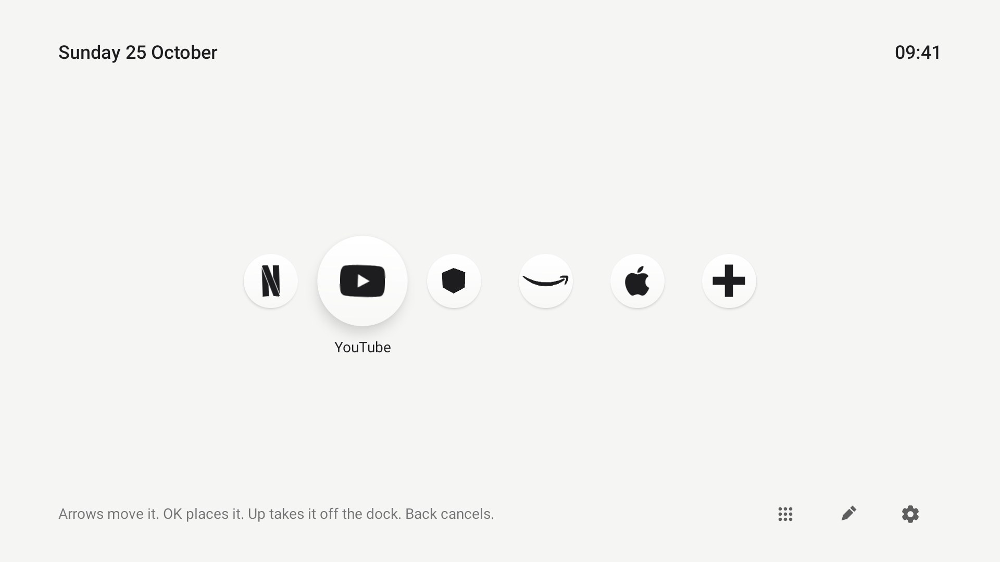
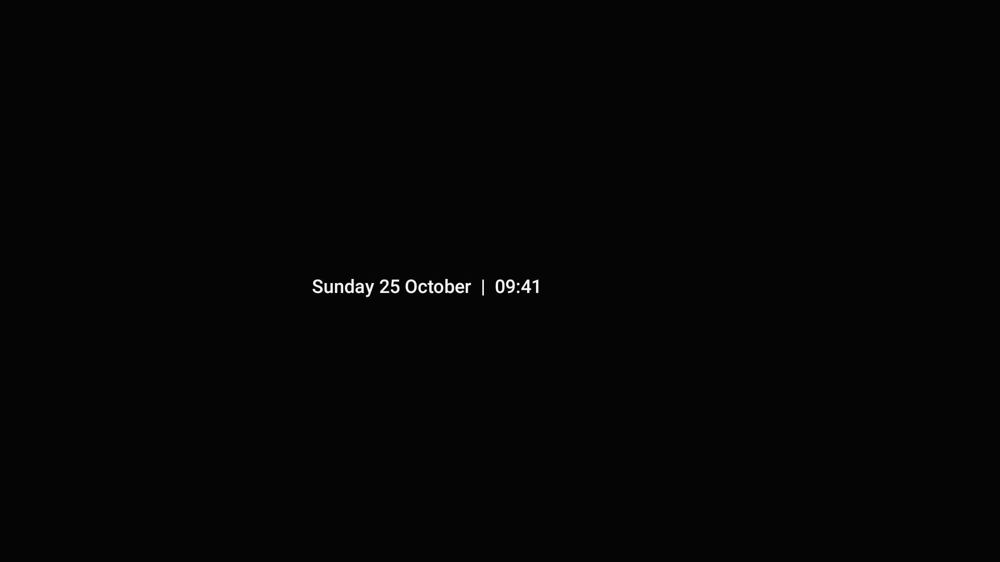

# FireOS-clean

Calm home screen for Fire TV Stick. No banners, no sponsored rows, no autoplay. Date left, time right, a row of glass discs for your apps. Flat light, flat dark, or your own wallpapers from a GitHub repo.



| Light | Dark |
|---|---|
|  |  |

| Settings, wallpaper | Settings, flat |
|---|---|
|  |  |

| Edit dock | Screensaver |
|---|---|
|  |  |

- Up to six apps on the dock. Well-known apps show their own mark, others get their icon cut down to a mark.
- Wallpapers on by default: nine built-in dunes, or your own GitHub repo, public or private.
- Screensaver is black, with the date and time drifting so no pixel stays lit.
- Settings in the same style: network, controllers, apps, wallpaper, shuffle, theme, dock order, screensaver, greeting.
- No account, no cloud, no tracking. Network is used only to read your wallpaper repo, if you name one.
- Undo with one command.

Tested on Fire TV Stick Lite (Fire OS 7). Other Fire OS 7 sticks should work. Not affiliated with Amazon.

## How it works

Fire OS will not let another app be the default home. This app reads the system log (`READ_LOGS`, granted once over ADB), sees Amazon's home start, covers it with a "Launching Home" screen and brings its own home up. About one second. Android blocks apps from opening screens for five seconds after Home, so the alarm service opens it instead.

## Install

Need a Fire TV with ADB debugging on, a computer on the same network (macOS or Linux), JDK 17, Android SDK.

1. TV: Settings > My Fire TV > Developer options > ADB debugging on. No Developer options? My Fire TV > About, press OK seven times on the device name. Note the IP under About > Network.
2. Computer:
   ```bash
   git clone https://github.com/RaghavaBoppudi/FireOS-clean.git && cd FireOS-clean
   python3 -m venv tools/venv && tools/venv/bin/pip install -r tools/requirements.txt
   ```
3. JDK and SDK. macOS:
   ```bash
   brew install openjdk@17 && brew install --cask android-commandlinetools
   export JAVA_HOME="$(brew --prefix openjdk@17)" PATH="$(brew --prefix openjdk@17)/bin:$PATH"
   yes | sdkmanager --sdk_root="$HOME/Library/Android/sdk" --licenses
   sdkmanager --sdk_root="$HOME/Library/Android/sdk" "build-tools;34.0.0" "platforms;android-28"
   ```
   Linux: install JDK 17 and the [command-line tools](https://developer.android.com/studio#command-line-tools-only), same `sdkmanager` line with `--sdk_root="$HOME/Android/Sdk"`. `firehome/build.sh` looks in `$ANDROID_HOME`, `~/Library/Android/sdk`, `~/Android/Sdk`.
4. Build and install. Accept "Allow USB debugging?" on the TV the first time.
   ```bash
   export TV_HOST=192.168.1.50            # stick IP
   firehome/install.sh                    # build, install, grant permissions, open
   firehome/install.sh --remove           # undo: Amazon's home returns on next Home press
   ```

Start with chosen apps on the dock (names as on screen, or package names, up to six):

```bash
firehome/install.sh --dock "Netflix,YouTube,Prime Video"
```

A dock you already edited stays unless you add `--reset-dock`.

## Edit the dock

Press Down to the buttons at bottom right, go to Edit, press OK.

| Press | Does |
|---|---|
| OK on an app | Pick it up |
| Left / Right, holding | Move it |
| OK, holding | Put it down |
| Up, holding | Lift off the dock. OK removes, Down puts back |
| OK on + | List apps not on the dock. OK on one adds it |
| Back | Cancel move, close list, leave edit |

One to six apps. Every change saves at once. Dock order is **Settings > Dock order**: last used first (default) or A to Z.

## Screensaver

Black screen, date and time moving to a new spot every ten seconds. Any button wakes it, and that press does nothing else. **Settings > Screensaver**: Off, 1, 5 (default), 10, 15, 30 minutes. Never starts during dock edit.

## Wallpapers

On by default with the built-in dunes. For your own, point the app at a GitHub repo:

1. Make a repo (public is simplest). Put JPG, PNG or WebP files at the top level. 16:9 is ideal. Other shapes get a centred 16:9 crop, scaled on the TV, so big photos are fine. 100 MB per file is GitHub's limit.
2. Name files `NUMBER-First-Last.jpg`, e.g. `1-Raghava-Boppudi.jpg`. Number sets the order (numeric: 2 before 10). Name becomes the credit at the bottom: `© Raghava Boppudi`. No number: shown last, no credit.
3. Optional: `profile.jpg` at the top level is the round picture next to the greeting. Never shown as a wallpaper.
4. Edit [`firehome/res/values/config.xml`](firehome/res/values/config.xml): `wallpaper_repo` = `USER/REPO`, `wallpaper_path` if images sit in a folder, `profile_name` for the greeting ("Hello, NAME", blank hides it). Run `firehome/install.sh` again.
5. TV: **Settings > Refresh**. It says how many wallpapers it found. After that, new images are picked up every 30 minutes when Home opens.

**Settings > Shuffle** sets how often it changes: 30 seconds to 1 hour, or daily at midnight. **Settings > Wallpaper** off gives the flat look and no network use.

| Situation | TV shows |
|---|---|
| Repo has valid images | Yours, in number order |
| Repo empty, or no repo set | Built-in dunes |
| GitHub unreachable | Last download, else dunes |

Template for the repo: [`wallpaper-repo-template/`](wallpaper-repo-template/). Dunes are made by [`firehome/wallpapers/generate.py`](firehome/wallpapers/generate.py) (CC0). Anyone who can push to the repo controls your wallpapers: keep write access to yourself, publish only images you have rights to.

### Private repo

TV needs a read-only token.

1. GitHub > Settings > Developer settings > Fine-grained tokens > Generate. Repository access: only the wallpaper repo. Contents: Read-only. Nothing else. Pick an expiry.
2. Save the token (`github_pat_...`) in git-ignored `firehome/wallpaper-token`, or pass `WALLPAPER_TOKEN=github_pat_... firehome/install.sh`.
3. The installer sends it over ADB. It sits in the app's private storage, not in the APK, not in git, and goes only to GitHub.
4. **Settings > Refresh**. Remove it with `firehome/install.sh --clear-token`.

Install with the token before you switch the repo to private, or the TV cannot see it. Anyone with ADB access to your TV can read the token, so keep it read-only and single-repo.

Refresh says "The repository has no images yet": images must be on the default branch, top level (or in `wallpaper_path`), JPG, PNG or WebP. Says "GitHub won't show this TV the repository": wrong name or token.

---

## Debloat tools

Older part of this repo, optional and separate from the home screen. Works over Wi-Fi even with no remote.

| Path | Does |
|---|---|
| [`tools/remote.py`](tools/remote.py) | Remote in your browser: D-pad, keys, typing, live screen preview |
| [`tools/firetv.py`](tools/firetv.py) | Pairs with the stick through Amazon's phone-app API (PIN on screen). No ADB, no remote needed |
| [`tools/tv.py`](tools/tv.py) | Pure-Python ADB client: shell, push, pull, `--screenshot`, `--reboot` |
| [`tools/disable.sh`](tools/disable.sh), [`restore.sh`](tools/restore.sh) | Record package state, switch a list off, replay the record to undo. `HIDE=1` for Fire OS 5 |
| [`examples/`](examples/) | Debloat lists: Stick 2nd gen, Stick Lite, Stick 4K 2018, Insignia F30, Toshiba |

No remote? Pair the browser remote first, then turn ADB debugging on:

```bash
export TV_HOST=192.168.1.50
python3 tools/firetv.py pair
python3 tools/firetv.py verify 1234                 # PIN on the TV
tools/venv/bin/python -I tools/remote.py --no-adb   # http://127.0.0.1:8765
```

Then:

```bash
tools/venv/bin/python -I tools/tv.py --probe                                    # model, Fire OS, Android
HIDE=1 tools/disable.sh examples/amazon-fire-tv-stick-2nd-gen-aftt/debloat.txt   # back up, switch off
```

Fire OS 5 allows one ADB connection at a time: keep the remote on `--no-adb` while scripts run. Fire OS 6 and 7 do not need `HIDE=1`.

Fire OS 5.2.9.5 blocks most of this. `pm disable-user` is refused for every package, `pm hide` works only on apps you installed, `pm uninstall -k --user 0` fails, and ADB-set accessibility services are dropped (so the home screen reads the log instead). On the 2nd gen stick the debloat hid seven apps and sped up animations. Newer Fire OS lets ADB disable much more.

**Undo and safety**
- Nothing is uninstalled. `disable.sh` saves each package's state to `~/.cleanyourtv/` first. `HIDE=1 tools/restore.sh <list> com.amazon.tv.launcher` restores. `firehome/install.sh --remove` brings Amazon's home back.
- No remote means Wi-Fi is the only way in. The lists keep Wi-Fi, remote-API, Bluetooth and pairing services. Factory reset is no fallback: setup after a reset needs a physical remote.
- After every restart Fire OS says "We cannot detect your remote". Press OK in the browser remote.
- Network ADB is full control of the stick. Turn it off when done, once you have another way to control the TV.

## Credits

Built on [CleanYourTV](https://github.com/Gathin23/cleanyourtv) by Gathin23 (MIT): ADB client, backup/restore scripts, Fire OS 6 and 7 lists. Browser remote, PIN pairing tool and the 2nd gen list by [whyashthakker](https://github.com/whyashthakker). Home screen in `firehome/` by Raghava Boppudi. App marks from [Simple Icons](https://simpleicons.org) (CC0), glyphs from [Material Symbols](https://github.com/google/material-design-icons) (Apache 2.0), see [`firehome/NOTICE.md`](firehome/NOTICE.md). MIT licence, see [`LICENSE`](LICENSE).
